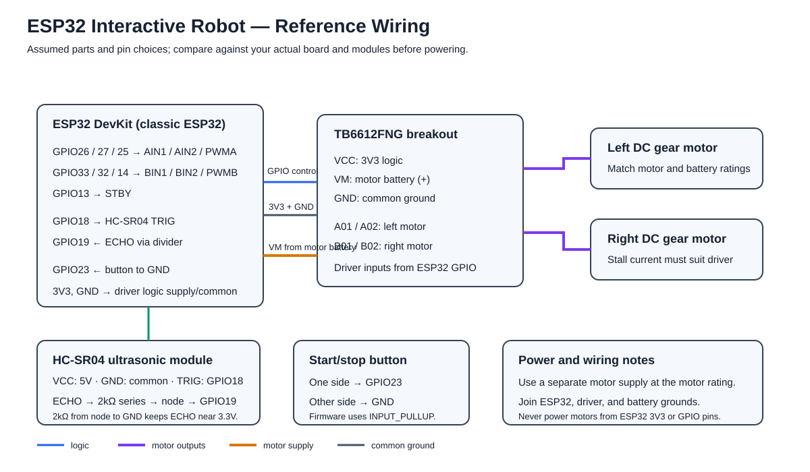

# Interactive ESP32 Robot with ChatGPT

This is an interactive robot assistant, not a mobile robot. A user asks questions; the robot uses ChatGPT to answer, shows cute expressions, and reacts to touch by shaking/moving.

## Behavior and architecture

- Microphone question → ESP32 over Wi-Fi → secure application backend → ChatGPT.
- Answer audio → speaker; friendly face/emoji → display.
- Touch sensor → ESP32 → expression change and servo shake.

The exact speech, ChatGPT, and backend services depend on the original build. Keep API credentials on the backend, never in public firmware.

## Circuit diagram

## Suggested reference hardware and pin map

These are assumptions for the diagram, not verified parts from the physical robot.

| Part / signal | Reference connection |
|---|---|
| Classic ESP32 DevKit | Controller and Wi-Fi |
| SSD1306 OLED SDA/SCL | GPIO21 / GPIO22 |
| TTP223 touch OUT | GPIO27 |
| SG90 servo signal | GPIO18; external regulated 5V |
| INMP441 mic SD/SCK/WS | GPIO33 / GPIO26 / GPIO25 |
| MAX98357A amp DIN/BCLK/LRC | GPIO32 / GPIO14 / GPIO13 |
| Speaker | Amplifier speaker output |
| Grounds | Common low-voltage ground |

Verify actual pinouts and voltage levels. Do not power servo or speaker from a GPIO.

## Repository code

src/interactive_robot.ino is a generated starter scaffold for touch-triggered expressions and servo movement. It does not implement microphone capture, speech recognition, ChatGPT requests, or spoken answers. Those need integration with the actual secure backend/audio pipeline. Install Adafruit GFX, Adafruit SSD1306, and ESP32Servo libraries for the example.

## Interview summary

“I’m developing an interactive ESP32 robot assistant. Users ask it questions and it uses a networked ChatGPT service to answer through a speaker. It displays friendly expressions and reacts to touch with a small shaking movement. It combines embedded I/O, audio, Wi-Fi, and an AI backend.”

Be ready to describe which microphone, display, actuator, backend, and speech services you actually used and personally tested.

## Accuracy and safety

The diagram and starter code are generated reference materials; actual hardware and validation are unconfirmed. Keep Wi-Fi credentials and API keys out of public code. Use rated supplies for the servo and amplifier.
